<div align="center">


<br>

[](https://bun.sh)
[](https://www.typescriptlang.org)
[](#-themes)
[](#-testing)
[](./LICENSE)

**A small terminal colorizer with helpers for headings, status messages, lists, prompts, and figlet logos.**

[Install](#-install) · [Quick start](#-quick-start) · [Themes](#-themes) · [Examples](#-examples) · [API](#-api-at-a-glance)

</div>

<br>

<div align="center">
  
</div>

## ✨ Features

- 🎨 **Simple painting**: wrap any string in a color with `colorizer.paint()`
- 🧱 **Ready-made helpers**: section headings, success/info/warning/error messages, lists, and prompts
- 🔤 **Figlet logos**: big ASCII banners for your CLI's splash screen
- 🌈 **Four built-in themes**: `ocean`, `ember`, `forest`, `mono`
- 🔌 **Switchable output**: pass `enabled` to turn colors on or off in one place
- 🧩 **Typed**: written in TypeScript, with declarations in [`types/`](./types)
- ⚡ **Bun-first**: fast install, fast tests, runnable examples

## 📦 Install

```bash
bun install
```

## 🚀 Quick start

```ts
import { Colorizer, Colors } from "./index.ts";

const colorizer = new Colorizer({ enabled: true });

console.log(colorizer.paint("Hello", Colors.GREEN));
colorizer.section("Status", Colors.CYAN);
colorizer.success("Everything is wired up.");
```

That's the whole setup: create a `Colorizer`, then print.

## 🎭 Themes

Every theme ships with the same set of colors for accents, success, info, warning, and error states, so swapping themes never changes your layout, only the mood. Each preview below is a live-typing terminal window.

<table>
  <tr>
    <td align="center" width="50%">
      <br>
      <sub><b>ocean</b> · the default</sub>
    </td>
    <td align="center" width="50%">
      <br>
      <sub><b>ember</b> · warm and loud</sub>
    </td>
  </tr>
  <tr>
    <td align="center" width="50%">
      <br>
      <sub><b>forest</b> · calm and green</sub>
    </td>
    <td align="center" width="50%">
      <br>
      <sub><b>mono</b> · no color, all contrast</sub>
    </td>
  </tr>
</table>

> [!NOTE]
> The animations above are illustrative previews. Run the [examples](#-examples) locally to see real output in your own terminal.

## 🧪 Examples

```bash
bun run example               # dashboard with the default ocean theme
bun run example ocean         # dashboard with a specific theme
bun run example:gallery       # every theme variation
bun run example:basic         # minimal usage
```

| Command | What you get |
| --- | --- |
| `bun run example` | Full dashboard in the default `ocean` theme |
| `bun run example <theme>` | Same dashboard in `ocean`, `ember`, `forest`, or `mono` |
| `bun run example:gallery` | Every theme rendered back to back |
| `bun run example:basic` | The smallest possible working script |

## 🧰 API at a glance

| Piece | Purpose |
| --- | --- |
| `new Colorizer({ enabled })` | Create a colorizer; `enabled` toggles color output |
| `colorizer.paint(text, color)` | Return `text` wrapped in the given color |
| `colorizer.section(title, color)` | Print a colored section heading |
| `colorizer.success(message)` | Print a success status line |
| `Colors` | Color constants such as `Colors.GREEN` and `Colors.CYAN` |

Lists, prompts, and figlet logos follow the same pattern. See [`lib/`](./lib) and [`examples/`](./examples) for the full set.

## 🗂 Project layout

```text
tint/
├── index.ts      # public entry point
├── lib/          # colorizer implementation
├── types/        # type declarations
├── examples/     # runnable demos (dashboard, gallery, basic)
└── test/         # bun test suite
```

## ✅ Testing

```bash
bun test
```

## 🛠 Regenerating the README animations

The SVGs in [`assets/`](./assets) are generated, so you can edit palettes or lines and rebuild:

```bash
bun scripts/gen-assets.mjs
```

## 🤝 Contributing

Issues and pull requests are welcome. If you add a theme, add it to the palette list in `scripts/gen-assets.mjs` so it shows up in the gallery above.

## 📄 License

<!-- Add a LICENSE file and name it here, e.g. MIT. -->c
